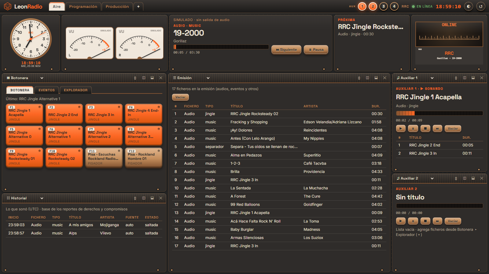
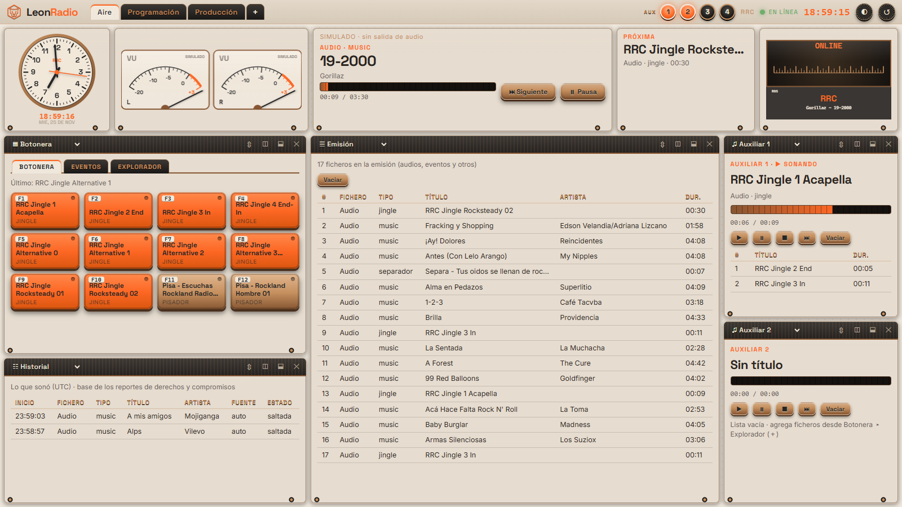
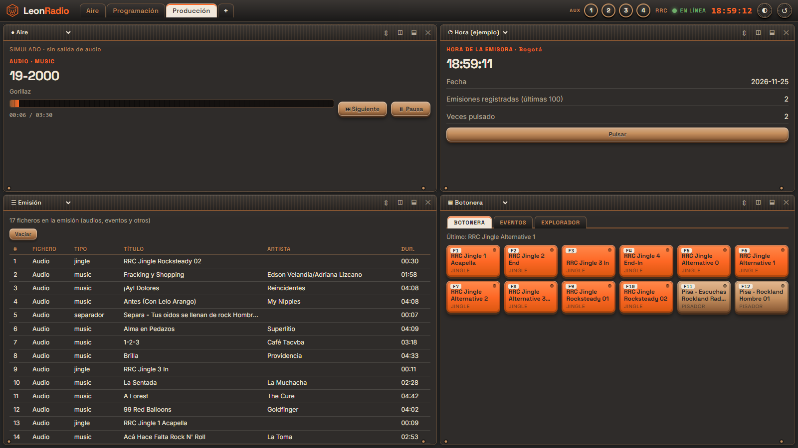

# LeonRadio

Automatizador de radio con experiencia de estación vintage, hecho para 2026.
Estación de prueba: **RRC – Rockland Radio Colombia** (https://rocklandradio.co/).

## Capturas

> Estado actual (F0 + F0.5). El audio, los niveles del VU, la emisión y las listas auxiliares son **simulados** hasta F1. Las piezas que se ven son de la emisora de pruebas RRC.

**Workspace «Aire»**: una franja superior delgada con Reloj, VU de agujas, Aire (con su transporte), Próxima y Dial/RDS; debajo, la **Botonera** (con las pestañas Botonera, Eventos y Explorador) y el Historial a la izquierda, y la **Emisión** como protagonista. Las **4 listas Auxiliares** se activan desde la barra de herramientas (AUX 1–4) y aparecen junto a la Emisión. Los encabezados de la franja se muestran al pasar el cursor (⇕ los alterna).



**Botonera ▸ Explorador**: navega la biblioteca por tipo y década, elige el destino (Emisión o una de las 4 Auxiliares) y agrega piezas con ＋.


**Tema claro** (misma disposición):



**Workspace «Programación»**: las áreas se dividen, unen y redimensionan, y cada una cambia de editor desde su selector.


**Workspace «Producción»**: arriba a la derecha, un editor aportado por un **addon** de ejemplo (`addons/ejemplo_hora_emisora`).



**En el teléfono**: en pantallas estrechas las áreas se apilan, la página se desplaza, los botones son táctiles y las tablas ocultan columnas secundarias.

<p>


</p>

Se regeneran con `tools/screenshots.py` (ver el encabezado del script).

```
leonradio/
├─ core/   Motor Python: biblioteca, historial de emisión, (audio y programación en camino)
├─ ui/     Interfaz HTML: consola vintage, tokens de marca y maquetas (prototypes/)
├─ docs/   Arquitectura y especificaciones (historial de emisión)
└─ ROADMAP.md
```

Tablero: [Proyecto LeonRadio](https://github.com/users/jonathanleongonzalez87/projects/1) · Issues: pestaña *Issues* de este repo.

## Iniciar el programa (Windows)
Haz doble clic en **`iniciar-leonradio.bat`**. La primera vez crea su entorno de Python (fuera de OneDrive, en
`%LOCALAPPDATA%\LeonRadio\venv`) e instala lo necesario; después arranca el servidor y abre el navegador en
`http://127.0.0.1:8765/`. Usa la carpeta de la emisora que esté junto al repo (`..\Rockland Radio`), o pásala como
argumento: `iniciar-leonradio.bat "D:\Mi Emisora"`. Si ya hay un servidor, solo abre el navegador.
Para detenerlo, cierra la ventana negra o pulsa Ctrl+C.

Necesita Python 3.12 o superior (python.org, marcando «Add python.exe to PATH») y conexión a internet la primera vez.

## Audio real
`iniciar-leonradio.bat` abre tu dispositivo de salida de Windows (WASAPI) y la emisión **empieza en pausa**: pulsa
**▶ Reproducir** en el panel Aire. El panel muestra el dispositivo en uso (si el VU dice «SIMULADO», no hay audio real).

- Probar la salida sin música: `%LOCALAPPDATA%\LeonRadio\venv\Scripts\leonradio.exe beep` (tono por el izquierdo y luego el derecho).
- Ver los dispositivos: `leonradio devices`. Elegir uno: variable `LEONRADIO_DEVICE` (número o parte del nombre).
- Empezar a sonar al arrancar: variable `LEONRADIO_AUTOPLAY=1`. Sin sonido (solo simulado): `leonradio serve --audio null`.
- Las listas (Emisión y 4 Auxiliares) reproducen **ficheros**: audios, eventos y otros ([docs/ficheros.md](docs/ficheros.md)).

## Probar la interfaz sin servidor
Para iterar rápido en la interfaz no hace falta servidor: haz doble clic en **`probar-ui.bat`**. Genera
`dist\LeonRadio-demo.html` (la interfaz **y el motor Python** en un solo archivo, con una insignia «DEMO LOCAL») y lo
abre en tu navegador como archivo local. El motor corre dentro del navegador con Pyodide, así que se prueba el mismo
código del servidor, sin copias. Tras cambiar el código, vuelve a ejecutar `probar-ui.bat` y recarga la página.

- La primera vez necesita internet (el navegador descarga Pyodide, ~10 MB, y luego lo guarda).
- Usa un catálogo de demostración (solo títulos y duraciones de la emisora RRC) y audio simulado.
- Para la emisora real, con tus archivos de audio, usa `iniciar-leonradio.bat`.

## Empezar (desarrollo)
```powershell
cd core
python -m venv .venv
.venv\Scripts\python -m pip install -e ".[api,dev]" httpx
.venv\Scripts\python -m pytest
.venv\Scripts\leonradio serve --library "C:\ruta\a\Rockland Radio"
# abre http://127.0.0.1:8765
```
La UI tiene áreas (◫ ⬓ ✕, selector de editor), workspaces (pestañas; doble clic = renombrar/eliminar) y un addon de ejemplo en `addons/`.

## Documentos
- [ROADMAP.md](ROADMAP.md)
- [docs/arquitectura.md](docs/arquitectura.md)
- [docs/historial-de-emision.md](docs/historial-de-emision.md)
- [docs/editores-y-addons.md](docs/editores-y-addons.md) — editores, workspaces y addons
- [core/README.md](core/README.md) · [ui/README.md](ui/README.md)

## Licencia
- Código (`core/`, `ui/`): **GPL-3.0-or-later** (`core/LICENSE`, `ui/LICENSE`).
- Documentación y diseño: **CC BY-SA 4.0** (`LICENSE`).
- El **isotipo hexagonal** (símbolo de LeonRadio, en la cabecera) y el nombre «Jonathan León» tienen derechos reservados y no están cubiertos por estas licencias — ver [NOTICE.md](NOTICE.md).

El audio de las emisoras no se versiona.
