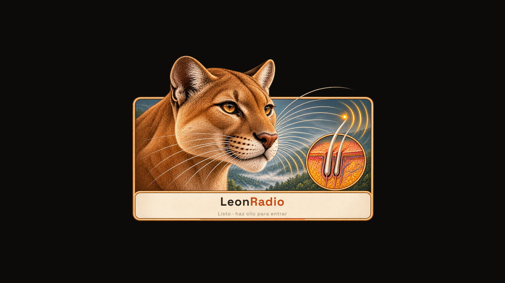
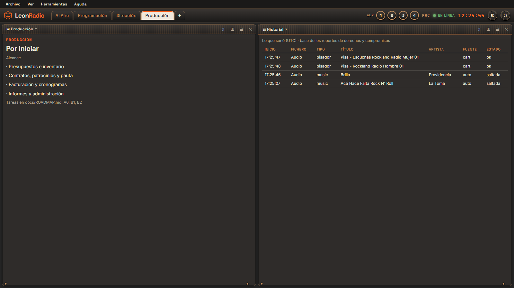

# LeonRadio

Automatizador de radio con experiencia de estación vintage, hecho para 2026.
Estación de prueba: **RRC – Rockland Radio Colombia** (https://rocklandradio.co/).

## Versión 0.2.1

Novedades de la 0.2.1: `iniciar-leonradio.bat` arranca en modo red y **Ayuda ▸ Conectar el teléfono (QR)** abre el control en el teléfono sin teclear la clave (mismo Wi-Fi); si la salida de audio guardada no existe, usa la predeterminada de Windows en vez del modo simulado.

Plataforma de gestión de una emisora con **audio real** (WASAPI), listas de ficheros, botonera, streaming, monitoreo remoto y paneles intercambiables. Novedades de la 0.2.0 sobre la 0.1.0:

- **Cuatro estaciones de trabajo** como pestañas: Al Aire, Programación, Dirección y Producción, sobre un núcleo común (ver [docs/estaciones.md](docs/estaciones.md)).
- **Base de datos persistente** (el historial y la biblioteca sobreviven a los reinicios) con migraciones y copias de seguridad automáticas.
- **Seguridad para la red local**: clave de acceso, sesión, comprobación de origen, carpetas permitidas y límites; el PC que emite entra sin clave.
- **Entidades compartidas** (Pieza, Artista, Álbum, Género) con su dueño por estación, y un contrato para que cada estación declare las suyas.
- **Streaming** a Icecast, **Monitores** para escuchar desde el teléfono o la tableta, **Preferencias** de audio por salida y **Navegador** integrado.
- Historial en la **hora de la emisora**, guía para colaborar, kit de desarrollo en `herramientas/` y audio propio de RRC para pruebas en `datos-de-prueba/`.



## Capturas

> Las piezas que se ven son de la emisora de pruebas RRC. Las capturas se hicieron sin salida de audio (VU «SIMULADO»); con `iniciar-leonradio.bat` suena de verdad.

**Estación «Al Aire»**: una franja superior delgada con Reloj, VU de agujas, Aire (barra con control deslizante, tiempo restante y hora de fin), Próxima y los **Controles** de reproducción (Play, Pausa, Stop, Siguiente y «parar tras la actual»). Debajo, **Varios** (un panel de pestañas: Botonera, Eventos, Explorador, Navegador y los que acoples con ＋) y el Historial a la izquierda, y la **Emisión** con la ficha de **Metadatos** debajo. Las **4 listas Auxiliares** se activan desde la barra de herramientas (AUX 1–4) y se abren en fila, con los mismos controles que la Emisión.


**Listas de ficheros**: elige una fila con un clic, **arrástrala** para reordenar y pulsa **Supr** para quitarla. La Botonera tiene 10 pads (1–9 y 0) que se activan con el **teclado numérico**: quedan encendidos mientras suenan y, al pulsarlos otra vez, se detienen.

**Varios ▸ Explorador**: navega la **biblioteca** por tipo y década o tu **disco duro** («Mi equipo»), elige el destino (Emisión o una de las 4 Auxiliares) y agrega piezas con ＋.


**Tema claro** (misma disposición):


**Las cuatro estaciones**: la barra superior tiene una pestaña por estación de trabajo —**Al Aire**, **Programación**, **Dirección** y **Producción**—, cada una con su diseño de paneles. Comparten la misma información y los paneles comunes (Historial, Metadatos…); Programación, Dirección y Producción tienen su panel de resumen y crecerán por separado (ver [docs/estaciones.md](docs/estaciones.md)). Las áreas se dividen, unen y redimensionan, y cada una cambia de editor desde su menú en columnas.




**En el teléfono**: en pantallas estrechas las áreas se apilan, la página se desplaza, los botones son táctiles y las tablas ocultan columnas secundarias.

<p>


</p>

Se regeneran con `tools/screenshots.py` (ver el encabezado del script).

```
leonradio/
├─ core/   Motor Python: biblioteca, historial de emisión, (audio y programación en camino)
├─ ui/     Interfaz HTML: consola vintage, tokens de marca y maquetas (prototypes/)
├─ docs/   Arquitectura y especificaciones (historial de emisión)
└─ ROADMAP.md
```

Tablero: [Proyecto LeonRadio](https://github.com/users/jonathanleongonzalez87/projects/1) · Issues: pestaña *Issues* de este repo.

## Iniciar el programa (Windows)
Haz doble clic en **`iniciar-leonradio.bat`**. La primera vez crea su entorno de Python (fuera de OneDrive, en
`%LOCALAPPDATA%\LeonRadio\venv`) e instala lo necesario; después arranca el servidor y abre el navegador en
`http://127.0.0.1:8765/`. Usa la carpeta de la emisora que esté junto al repo (`..\Rockland Radio`), o pásala como
argumento: `iniciar-leonradio.bat "D:\Mi Emisora"`. Si ya hay un servidor, solo abre el navegador.
Para detenerlo, cierra la ventana negra o pulsa Ctrl+C.

**Aviso:** la primera vez con una biblioteca grande el arranque tarda (se lee todo el audio para identificarlo, ~100 MB/s: puede ser de varios minutos) y el progreso sale en la ventana negra. Los arranques siguientes solo comparan tamaño y fecha: ~1,5 s por cada 20.000 archivos.

Necesita Python 3.12 o superior (python.org, marcando «Add python.exe to PATH») y conexión a internet la primera vez.

## Audio real
`iniciar-leonradio.bat` abre tu dispositivo de salida de Windows (WASAPI) y la emisión **empieza en pausa**: pulsa
**▶ Play** en los Controles. El panel Aire muestra el dispositivo en uso (si dice «SIMULADO», no hay audio real).

- **Monitores** (pestaña *Monitores* de Varios): escucha la emisión desde el teléfono, la tableta u otra PC de la red (ver *Usarlo en tu red local*), con dos monitores vintage, interruptor y perilla de volumen estilo consola. El volumen es de cada dispositivo. Ábrelo en un dispositivo distinto al que emite.
- **Streaming** (pestaña *Streaming* de Varios, como BUTT): transmite la mezcla principal a un servidor **Icecast 2** en MP3 (64–320 kbps), con reconexión automática, título y artista de cada canción, y grabación a archivo. Configura servidor, usuario, contraseña y punto de montaje en la pestaña *Servidor*; la contraseña se guarda solo en tu archivo de configuración local.
- **Preferencias** (menú *Archivo ▸ Preferencias…* o Ctrl+,): elige la tarjeta de sonido de la salida principal, las 4 Auxiliares y la Botonera, agrupadas por interfaz de Windows; cada una puede salir por una tarjeta distinta. Se aplica al momento y se recuerda en `%LOCALAPPDATA%\LeonRadio\config.json`. La escucha previa y las entradas de línea se guardan, pero aún no se usan.

- Probar la salida sin música: `%LOCALAPPDATA%\LeonRadio\venv\Scripts\leonradio.exe beep` (tono por el izquierdo y luego el derecho).
- Ver los dispositivos: `leonradio devices`. Elegir uno: variable `LEONRADIO_DEVICE` (número o parte del nombre).
- Empezar a sonar al arrancar: variable `LEONRADIO_AUTOPLAY=1`. Sin sonido (solo simulado): `leonradio serve --audio null`.
- Las listas (Emisión y 4 Auxiliares) reproducen **ficheros**: audios, eventos y otros ([docs/ficheros.md](docs/ficheros.md)).

## Usarlo en tu red local
Para abrirlo también desde el teléfono, la tableta u otra PC: haz doble clic en **`iniciar-leonradio.bat`** y usa Ayuda ▸ Conectar el teléfono (QR) (o
`leonradio serve --host 0.0.0.0`). La ventana muestra la dirección, por ejemplo `http://192.168.1.20:8765/`; ábrela
desde un dispositivo de la misma red. Todos ven y controlan la misma emisión; cada navegador guarda su propio diseño de
paneles. El audio sale solo por la tarjeta de sonido del PC que ejecuta LeonRadio; los demás dispositivos pueden
escucharlo con el panel **Monitores**.

- Windows pedirá permiso en el Firewall: permite las **redes privadas** (si tu red está marcada como pública, cámbiala a
  privada o crea una regla para el puerto 8765).
- **Clave de acceso**: los dispositivos de la red la piden. Se genera la primera vez y se muestra **una sola vez** en la
  ventana negra; si la pierdes, `leonradio clave` crea otra. El PC que emite entra sin clave. Tras 5 intentos fallidos
  se bloquea esa dirección 15 minutos. La conexión **no va cifrada** (HTTP): úsalo solo en una red de confianza y no
  abras el puerto 8765 hacia internet. Usuarios y roles llegarán más adelante (tarea A9).

## Probar la interfaz sin servidor
Para iterar rápido en la interfaz no hace falta servidor: haz doble clic en **`probar-ui.bat`**. Genera
`dist\LeonRadio-demo.html` (la interfaz **y el motor Python** en un solo archivo, con una insignia «DEMO LOCAL») y lo
abre en tu navegador como archivo local. El motor corre dentro del navegador con Pyodide, así que se prueba el mismo
código del servidor, sin copias. Tras cambiar el código, vuelve a ejecutar `probar-ui.bat` y recarga la página.

- La primera vez necesita internet (el navegador descarga Pyodide, ~10 MB, y luego lo guarda).
- Usa un catálogo de demostración (solo títulos y duraciones de la emisora RRC) y audio simulado.
- Para la emisora real, con tus archivos de audio, usa `iniciar-leonradio.bat`.

## Empezar (desarrollo)
```powershell
cd core
python -m venv .venv
.venv\Scripts\python -m pip install -e ".[api,dev]" httpx
.venv\Scripts\python -m pytest
.venv\Scripts\leonradio serve --library "C:\ruta\a\Rockland Radio"
# abre http://127.0.0.1:8765
```
La UI tiene áreas (◫ ⬓ ✕, menú de editores en columnas), workspaces (pestañas; doble clic = renombrar/eliminar) y un addon de ejemplo en `addons/`.

## Documentos
- [docs/guia-basica.md](docs/guia-basica.md) — **empieza aquí si vas a colaborar** · [docs/estaciones.md](docs/estaciones.md) · [docs/entidades.md](docs/entidades.md) · [docs/marca.md](docs/marca.md)
- [docs/ROADMAP.md](docs/ROADMAP.md) (seguimiento) · [ROADMAP.md](ROADMAP.md) (visión y fases)
- [docs/arquitectura.md](docs/arquitectura.md)
- [docs/historial-de-emision.md](docs/historial-de-emision.md)
- [docs/editores-y-addons.md](docs/editores-y-addons.md) — editores, workspaces y addons
- [core/README.md](core/README.md) · [ui/README.md](ui/README.md)

## Licencia
- Código (`core/`, `ui/`): **GPL-3.0-or-later** (`core/LICENSE`, `ui/LICENSE`).
- Documentación y diseño: **CC BY-SA 4.0** (`LICENSE`).
- El **isotipo hexagonal** (símbolo de LeonRadio, en la cabecera) y el nombre «Jonathan León» tienen derechos reservados y no están cubiertos por estas licencias — ver [NOTICE.md](NOTICE.md).

El audio de las emisoras no se versiona, salvo el material propio de RRC para pruebas en [`datos-de-prueba/`](datos-de-prueba/LEEME.md) (sin la música comercial).
