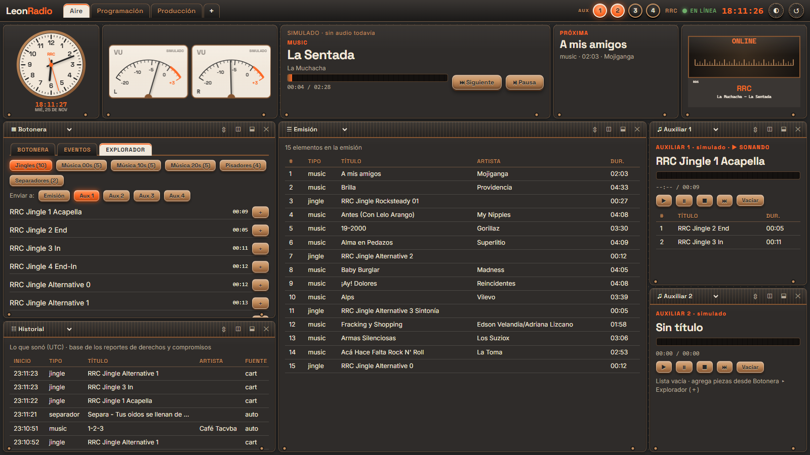
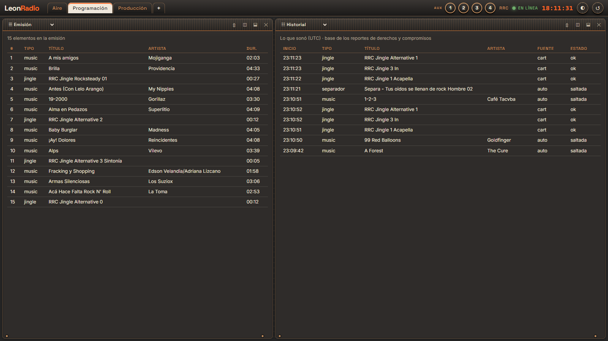
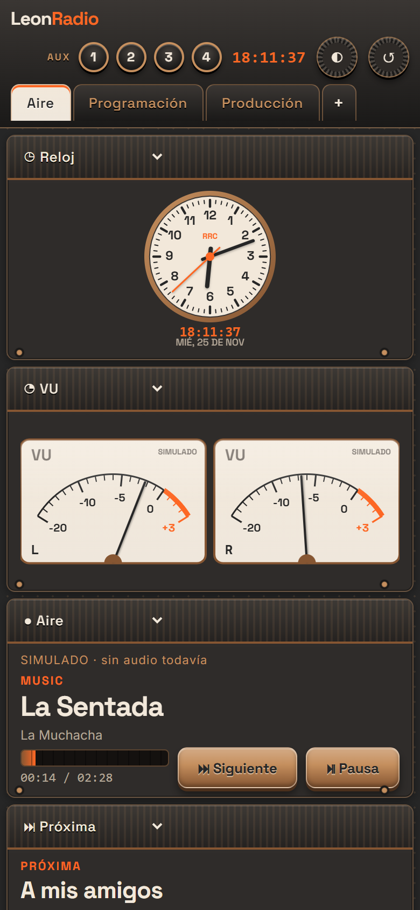
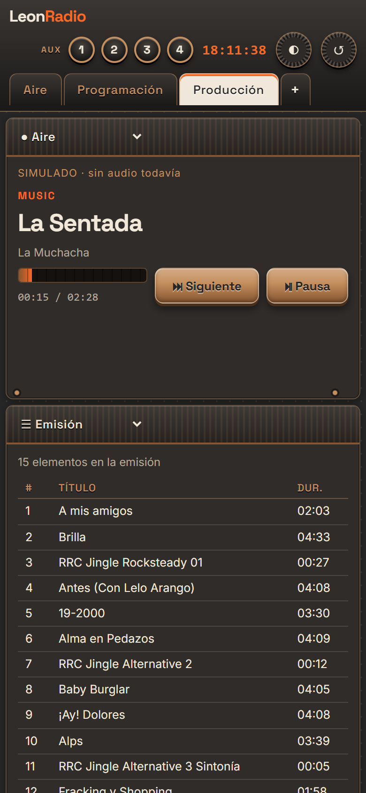

# LeonRadio

Automatizador de radio con experiencia de estación vintage, hecho para 2026.
Estación de prueba: **RRC – Rockland Radio Colombia** (https://rocklandradio.co/).

## Capturas

> Estado actual (F0 + F0.5). El audio, los niveles del VU, la emisión y las listas auxiliares son **simulados** hasta F1. Las piezas que se ven son de la emisora de pruebas RRC.

**Workspace «Aire»**: una franja superior delgada con Reloj, VU de agujas, Aire (con su transporte), Próxima y Dial/RDS; debajo, la **Botonera** (con las pestañas Botonera, Eventos y Explorador) y el Historial a la izquierda, y la **Emisión** como protagonista. Las **4 listas Auxiliares** se activan desde la barra de herramientas (AUX 1–4) y aparecen junto a la Emisión. Los encabezados de la franja se muestran al pasar el cursor (⇕ los alterna).


**Botonera ▸ Explorador**: navega la biblioteca por tipo y década, elige el destino (Emisión o una de las 4 Auxiliares) y agrega piezas con ＋.



**Tema claro** (misma disposición):


**Workspace «Programación»**: las áreas se dividen, unen y redimensionan, y cada una cambia de editor desde su selector.



**Workspace «Producción»**: arriba a la derecha, un editor aportado por un **addon** de ejemplo (`addons/ejemplo_hora_emisora`).


**En el teléfono**: en pantallas estrechas las áreas se apilan, la página se desplaza, los botones son táctiles y las tablas ocultan columnas secundarias.

<p>


</p>

Se regeneran con `tools/screenshots.py` (ver el encabezado del script).

```
leonradio/
├─ core/   Motor Python: biblioteca, historial de emisión, (audio y programación en camino)
├─ ui/     Interfaz HTML: consola vintage, tokens de marca y maquetas (prototypes/)
├─ docs/   Arquitectura y especificaciones (historial de emisión)
└─ ROADMAP.md
```

Tablero: [Proyecto LeonRadio](https://github.com/users/jonathanleongonzalez87/projects/1) · Issues: pestaña *Issues* de este repo.

## Empezar
```powershell
cd core
python -m venv .venv
.venv\Scripts\python -m pip install -e ".[api,dev]" httpx
.venv\Scripts\python -m pytest
.venv\Scripts\leonradio serve --library "C:\ruta\a\Rockland Radio"
# abre http://127.0.0.1:8765
```
La UI tiene áreas (◫ ⬓ ✕, selector de editor), workspaces (pestañas; doble clic = renombrar/eliminar) y un addon de ejemplo en `addons/`.

## Documentos
- [ROADMAP.md](ROADMAP.md)
- [docs/arquitectura.md](docs/arquitectura.md)
- [docs/historial-de-emision.md](docs/historial-de-emision.md)
- [docs/editores-y-addons.md](docs/editores-y-addons.md) — editores, workspaces y addons
- [core/README.md](core/README.md) · [ui/README.md](ui/README.md)

## Licencia
- Código (`core/`, `ui/`): **GPL-3.0-or-later** (`core/LICENSE`, `ui/LICENSE`).
- Documentación y diseño: **CC BY-SA 4.0** (`LICENSE`).
- Las maquetas históricas de `ui/prototypes/` incluyen la marca «Jonathan León» (derechos reservados) — ver [NOTICE.md](NOTICE.md). La interfaz actual no la usa.

El audio de las emisoras no se versiona.
